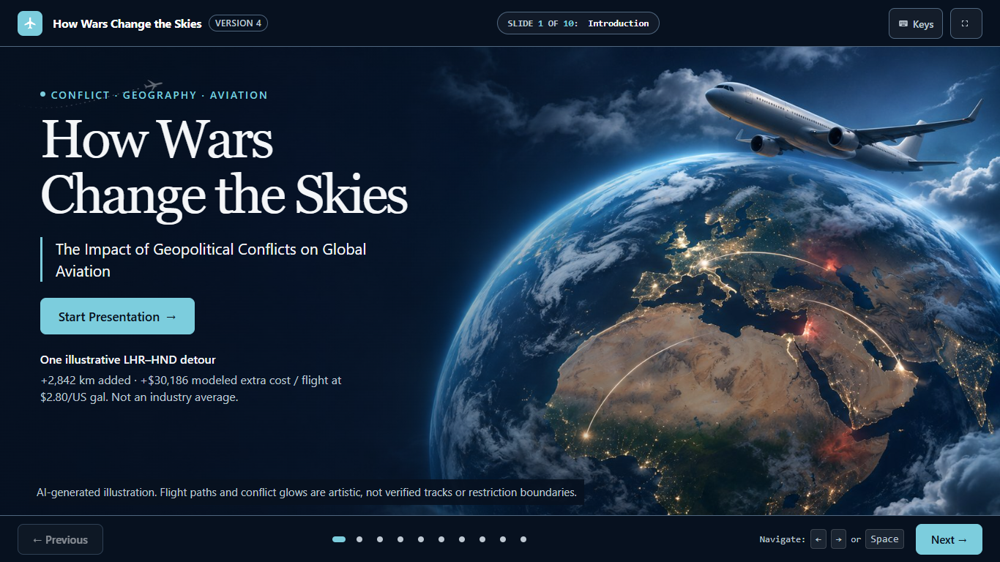
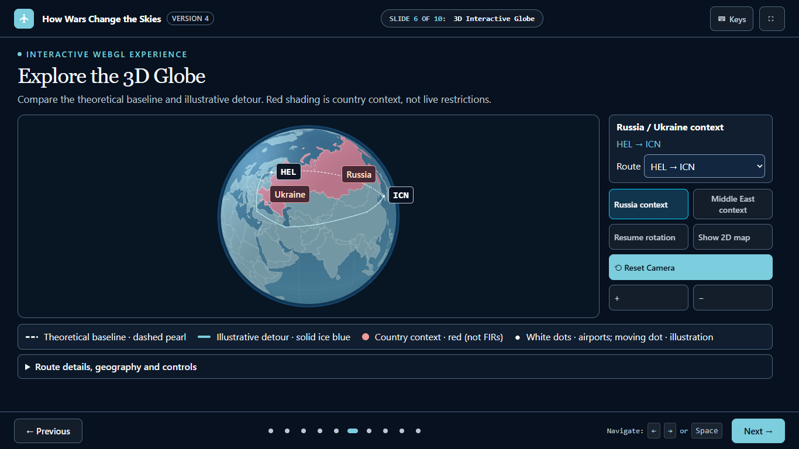

# How Wars Change the Skies — Version 4 University Submission

An English, 10-slide educational presentation about conflict, airspace restrictions, illustrative rerouting and airline decisions. Version 2 improves geographic accuracy, data transparency and visual design while preserving navigation, case-study tabs, route selectors, globe controls, sliders and all four simulator strategies.

**Published application release:** [Version 4 — `4e73a2a528395aa939251579dfd51ca6e8089a86`](https://github.com/katznoa22-hash/how-wars-change-the-skies/commit/4e73a2a528395aa939251579dfd51ca6e8089a86), successfully published to the public repository's `main` branch. The original V1–V3 history and V2/V3 tags are preserved. The release snapshot has 64 repository files and exactly 25 changed files relative to V3; these counts describe that immutable release, not a later documentation update.

## Evaluator guide

- **Run the presentation:** [local preview instructions](#preview-locally) and [HTML presentation source](index.html). GitHub displays source files; a hosted presentation URL is not claimed.
- **Inspect the analytical work:** [Python analysis](analysis.py), [airport validation](scripts/validate_airports.py), [generated data](data/scenarios.json) and [formulas, evidence and limitations](SOURCES.md).
- **Review verification:** [test instructions](#reproduce-calculations-and-run-checks), [Python checks](tests/model_checks.py), [browser checks](tests/browser.mjs) and [recorded browser report](artifacts/v4/browser-results.json).
- **Assess the development process:** [AI-development evidence index and publication closeout](prompts/ai-development-audit.md), [PRD and as-built scope](PRD.md) and [chronological V4 log](prompts/codex-development-v4.md).
- **See the actual slides:** [screenshots](#screenshots) and [all ten captures](artifacts/v4/preview.html). Open the HTML gallery locally; direct PNG links also work in GitHub.

## Development journey and review evidence

| Version | User decisions and implemented progression | Recorded evidence |
| --- | --- | --- |
| **V1 — concept and scope** | English, ten-slide academic presentation centered on a 3D globe and airline decision exercise. Initial implementation already included interactive features; the Python model was still a planned requirement. | [Original ChatGPT prompt and response summary](prompts/01-chatgpt-conversation.md), [planning summary](prompts/01-planning.md), [Antigravity development record](prompts/antigravity-development.md). |
| **V2 — reliable interaction and analysis** | Preserve the presentation while improving globe geography, three illustrative route comparisons, reproducible quantitative analysis and scenario-dependent simulator behavior. Distinguish sourced facts, assumptions and invented scores. | [Codex stage prompts/actions](prompts/codex-stage-record.md), [source/model audit](SOURCES.md). |
| **V3 — usability and repair** | Improve projector readability and keyboard/fallback behavior. User-reported non-responsive camera buttons led to native pointer/camera tests and targeted availability/reset fixes. | [V3 prompts, repair and release record](prompts/codex-development-v3.md). |
| **V4 — published final presentation** | User-selected cinematic aviation composition; explicit rejection of gold-heavy alternatives in favor of navy/white/blue/cyan. Independent pre-release scrutiny led to bounded numerical comparison tests and clear ZIP/Git validation. Publication was explicitly approved and verified. | [V4 exact prompts and labelled summaries](prompts/codex-development-v4.md), [pre-release checklist](artifacts/v4/pre-release-audit.md). |

Evidence labels matter: the ChatGPT conversation file contains one recorded original user prompt and a response summary; the planning file is explicitly a summary. Later logs distinguish exact user prompts from action summaries. The original selected reference bitmap and full earlier image-selection exchange were unavailable; V4 follows the user's detailed description and explicit design reversal, with no invented verbatim historical dialogue.

**Review the actual deck:** [cover screenshot](artifacts/v4/v4-slide-01-projector.png) · [interactive-globe screenshot](artifacts/v4/v4-slide-06-projector.png) · [all ten screenshots](artifacts/v4/preview.html) · [browser evidence](artifacts/v4/browser-results.json). [PRD and as-built scope](PRD.md) · [sources, formulas and limits](SOURCES.md) · [current development log](prompts/codex-development-v4.md).

**Python's actual contribution:** standard-library analysis.py validates airport inputs and computes spherical baseline/waypoint distances, extra time, fuel, incremental expense and direct CO2, exporting data/scenarios.json and data/presentation-data.js. It is an offline reproducible analysis/data-generation step, not a running Python web backend, trained AI or safety/airline forecast. JavaScript handles the live sliders, simulator and rendering using the same documented assumptions. Preview needs no Python model regeneration; the bundled outputs work offline. Optional `py analysis.py` rewrites generated files and may differ in last-bit float representation across Python versions/platforms; it is not a required preview/test step.

Version 3 previously refined that presentation on the preserved `version-3` branch: larger, high-contrast projector typography; focused keyboard navigation; globe controls and legends outside the map; keyboard globe rotation/zoom; a fuel/other-operations expense breakdown; a four-response simulator comparison; and clearer final conclusions with expandable academic sources. The presentation still has exactly ten slides. Validated Version 2 model assumptions, data, source links and local dependencies are unchanged. The existing `assets/v2.js` continues to hold the shared model/rendering functions; the name does not indicate a separate presentation or a changed scientific model.

Version 2 is preserved at annotated tag `v2.0`, commit `1dd228500b5ba5708412495f1c43704468728b75`. Version 3 remains at annotated `v3.0`, commit `ef15a06038502f249bd702255401e1f09dc738ee`. Version 4 was published to `origin/main` as `4e73a2a528395aa939251579dfd51ca6e8089a86`; the local working branch is `version-4`. No V4 tag was created. [The V3 log](prompts/codex-development-v3.md) preserves its original prompts and repair/release preparation. [The evidence index](prompts/ai-development-audit.md#publication-closeout) records the verified V4 publication and the corrected verification-script assertion. Historical pre-release statements below and in dated audit records describe their original checkpoints, not the current publication status.

## Preview locally

From the project directory, run:

```powershell
py -m http.server 8000 --bind 127.0.0.1
```

Open **http://127.0.0.1:8000/** in Chrome or Edge. Stop the server with Ctrl+C. You can also open `index.html` directly: libraries and data are local and no fetch request is needed. Use a browser with WebGL for the 3D view; the 2D map is available if WebGL fails. No npm installation or internet connection is needed for the presentation. Source links open external sites when clicked.

Navigate with Previous/Next, slide dots, arrows, Space, Page Up/Down, Home/End or number keys (0 opens slide 10). Press F for fullscreen or use its button. Inputs keep their own keyboard controls. On slide 6, drag to rotate, scroll to zoom, reset the camera, pause rotation or switch to the 2D map. Slide 5 and slide 6 share the route selection. On slide 9, choose either scenario, one of four strategies and a jet fuel price; expand the assumptions disclosure.

For keyboard globe interaction, Tab to the globe on slide 6 and use **W/A/S/D** to rotate and **+/−** to zoom. Arrow keys remain slide navigation. The keyboard-shortcuts dialog captures focus and returns it when closed. Reduced-motion preferences pause automatic rotation, including changes while presenting. If WebGL is unavailable or its context is lost, the 2D map retains route selection; reload to restore 3D.

On slide 7, use the selected route's extra hours (explicitly rounded to the existing 0.1-hour slider step) or reset inputs. The stacked bar divides incremental fuel and other operating expense using the same validated calculation. On slide 9, expand “Compare responses and inspect assumptions” to view all four responses at the current scenario/price, full feedback and the invented-score assumptions. Formulas, geographic limits and academic references remain available in disclosures so the main slide can stay readable. Expanded disclosures and narrow/mobile screens intentionally allow vertical scrolling.

## What changed

- Accurate Natural Earth country geometry renders a detailed cartographic Earth texture, visible country boundaries and dated scenario context. Airport markers, labels, dashed baseline paths, solid detours and an animated route marker support geographic reading.
- Great-circle interpolation follows spherical geometry; illustrative detours use the same waypoints as Python distance calculations. The optional 2D map shows the same data.
- Cost and CO₂ use one fuel-mass assumption with explicit US-gallon conversion. Historical facts link to sources; calculated estimates and invented simulator scores are labeled separately.
- Simulator scenario selection changes outcomes. Suspension punctuality is N/A, and all strategies disclose assumptions without claiming safety or profitability.
- Local libraries remove CDN dependence. Responsive layouts, keyboard focus, keyboard-operable strategy cards, accessible dot buttons and reduced-motion defaults improve presentation access.

## Screenshots

These are actual 1366×768 captures from the recorded V4 browser run, not a claim of physical projector testing or every interaction state. The cover contains AI-generated illustrative artwork; the globe capture shows the functional Three.js view. No screenshot was changed for this documentation update.





[All ten slide captures](artifacts/v4/preview.html) · [Generated hero-image provenance](assets/hero-v4-provenance.json)

## Reproduce calculations and run checks

Version 4 preview: [all ten projector screenshots](artifacts/v4/preview.html) and [recorded V4 browser report](artifacts/v4/browser-results.json). Earlier Version 3 evidence remains in artifacts/ unchanged.

Python uses only its standard library. Downloaded assets and generated data are already included.

```powershell
py -B scripts/validate_airports.py
py -I -B -m unittest discover -s tests -p '*checks.py'
node --check assets/v2.js
node --check tests/browser.mjs
node tests/browser.mjs
```

The browser suite requires Node 22+ with built-in WebSocket support and installed Chrome/Chromium or Edge. Set `BROWSER_PATH` to an installed executable if automatic discovery does not find it. No package installation is required. It starts a local test server on port 8765 and a headless browser on debugging port 9222, stores an isolated profile in `.browser-profile/`, writes Version 4 results/screenshots to `artifacts/v4/`, then closes its browser and server. Do not run it concurrently with another process using those ports.

The Version 3 suite also records 30 projector-layout measurements (all ten slides at 1280×720, 1366×768 and 1920×1080), checks horizontal/vertical fit with disclosures closed, and saves `artifacts/v3-slide-01-projector.png` through `v3-slide-10-projector.png`. It checks every simulator scenario/strategy/price combination, chart totals, keyboard focus, route-hour/reset controls and actual WebGL context-loss fallback. The generated report continues to sanitize workstation paths. Projector screenshots are test evidence, not backup copies or another application.

`analysis.py` generates `data/scenarios.json` and its browser script companion, `data/presentation-data.js`. Both come from the same inputs. Independent coordinate references reject reversed or geographically incorrect airport inputs before analysis.

## Evidence, limitations and development history

See [SOURCES.md](SOURCES.md) for the slide-by-slide audit, exact formulas, source URLs, dates, licenses and coordinate verification. See [prompts/antigravity-development.md](prompts/antigravity-development.md) for the actual Antigravity history followed by the Codex stage, and [prompts/codex-validation.md](prompts/codex-validation.md) for executed checks and results.

This model is **illustrative, not operational flight planning**. Red country shading is historical geographic context, not exact FIR or restriction geometry. Routes are not verified historical flight tracks or approved safe alternatives. Airport coordinates are community dataset snapshots checked within 5 km of independent airport references, not certified ARPs. Speed, fuel burn, costs and simulator scores are assumptions. No live airspace feed, winds, aircraft performance model or full climate assessment is included. WebGL behavior varies by graphics hardware; 2D provides a fallback.

Version 1 remains at commit `9a9ce56dfe23dc5f06a501c3e7582c605c540362`, previously verified on GitHub main. Tests verify its ancestry and original HTML checksum directly from Git history, so a clone does not need local backups (a shallow clone must include Version 1 history). A byte-verified original HTML backup is also kept locally at `backups/version-1/index.html`; backups and browser profiles are ignored by Git. PRD.md retains the original planning document and appends a Version 4 as-built mapping. The Version 2 release is identified by the annotated `v2.0` tag; publishing requires separate approval.

`scripts/fetch_assets.py` is an explicit asset-refresh utility, not a startup dependency. It uses only the reviewed URLs, validates paths and backs up existing destinations. Do not rerun it merely to preview. `scripts/upgrade_v2.py` is the one-time migration record and refuses a second migration or a missing/invalid Version 1 backup.

## Version 4 cinematic presentation

The final candidate uses midnight navy, pearl white and restrained ice-blue/cyan accents. Gold UI styling is superseded. Local/system serif headings and legible sans-serif body text keep the deck suitable for projection. The title, exact subtitle and Start Presentation control are real HTML; the text-free Earth/aircraft background is AI-generated illustrative artwork, optimized locally to a 198 KB JPEG. It is not satellite evidence, a flight track or restriction geometry. [Generation provenance and exact prompt](assets/hero-v4-provenance.json).

All ten slides and existing interactions remain: cases; three route comparisons synchronized with the 3D/2D view; rotation, pointer/keyboard zoom and Reset Camera; cost sliders; all 48 simulator combinations; source disclosures and presentation navigation. The dashed pearl baseline and solid ice-blue detour use shared CSS/renderer tokens. Case controls expose selected state. Ctrl/Meta/Alt browser shortcuts are respected, inactive slides cannot intercept clicks, control targets are larger, and reduced motion/pause stops the illustrative route marker as well as rotation.

The scientific model still has schema version 2 and remains in the existing shared assets/v2.js runtime; this is intentional. No validated source-data file or analysis.py formula was changed. Original v2.css/v3.css remain historical files; assets/v4.css is the sole active enhancement stylesheet above the original layout rules in index.html.

See [the complete V4 prompt, development and validation log](prompts/codex-development-v4.md). Tests now protect the immutable v3.0 tag and compare validated inputs/assets to that release. Use a full-history clone with tags for preservation tests. The browser suite checks independent simulator expenses/scores, native pointer camera changes, touch/keyboard operation, modifier-safe shortcuts, fallback faults, disclosure reflow and solid-token contrast. Automated contrast checks are not a screen-reader audit or a claim of full WCAG compliance. Software WebGL screenshots do not establish physical projector or hardware GPU quality.

Version 1: 9a9ce56dfe23dc5f06a501c3e7582c605c540362. Version 2: v2.0 / 1dd228500b5ba5708412495f1c43704468728b75. Version 3: v3.0 / ef15a06038502f249bd702255401e1f09dc738ee. Version 4: published commit `4e73a2a528395aa939251579dfd51ca6e8089a86`. Preserve this application release when making later documentation-only changes.

### Historical pre-release candidate validation — 9 November 2026

`py -B scripts/validate_airports.py`: six airports passed. `py -B -m unittest discover -s tests -p '*checks.py'`: 9 tests passed. `node --check assets/v2.js`, `node --check tests/browser.mjs` and extracted inline JavaScript checks passed. `node tests/browser.mjs`: 29 groups passed, including 48 independently checked simulator combinations and 30 projector cases. Four pinned asset hashes and ten-slide order were verified. The report preserves deliberate WebGL/missing-resource fault diagnostics; no uncaught exceptions or unexpected normal-mode asset/console errors were observed. See the V4 log for failed intermediate runs, fixes, source-access limitations and manual validation still required. This is a local candidate awaiting user review, not a published final release.


### Historical pre-release audit and source-ZIP validation

The following paragraphs retain the pre-publication validation record. Their pending-approval wording describes that checkpoint; publication was subsequently approved and verified as documented in the [closeout](prompts/ai-development-audit.md#publication-closeout). The independent external floating-point observation remains unresolved.

The original nine tests passed again in the original Windows/Python 3.13.2 Git tree before changes. A narrowly scoped test fix now compares only the eight derived numeric route fields within explicit absolute floating-point budgets, retaining exact input/assumption/schema comparisons and unchanged Git-protected data/formulas. Three regression tests cover last-bit/sequential-sum variation, out-of-budget/non-finite values and altered inputs/structure. The full suite now contains **12 tests: nine model tests and three Git-history tests**. Earlier nine-test results above are historical executed runs, not the current total.

Python 3.12 changed float summation accuracy; platform math libraries can also differ. In a controlled sequential-summation experiment, detour distances differed by 1.82e-12 km and derived costs by at most 2.18e-11 USD, with unchanged displayed values. This reproduces a last-bit equality problem but does not prove the cause of the independent review without its traceback/version. Numerical budgets are documented in tests/model_checks.py and the [pre-release audit](artifacts/v4/pre-release-audit.md); they are not estimates of model uncertainty. analysis.py and validated JSON were not modified or regenerated.

For the original full-history Git clone, run:

```powershell
py -B -m unittest discover -s tests -p '*checks.py' -v
```

For a source ZIP without .git, run only the model checks explicitly:

```powershell
py -B tests/model_checks.py ModelChecks -v
```

The ZIP command passes nine model tests and does **not** verify Git history, original release hashes or ancestry. The default full suite intentionally retains all three strict Git checks; do not represent their absence in a ZIP as history verification. Model-only checks were also executed in a temporary source-only directory without .git on this workstation; another OS/Python build was not available.

The fresh audit browser run passed 29 groups, 48 simulator combinations and 30 layouts. See the [PASS/FAIL checklist, exact commit candidates and caveats](artifacts/v4/pre-release-audit.md). No release operation has been performed.


Latest minimal-change readiness check: an actual ZIP of the current 64 source/evidence files was extracted into a clean non-Git directory and tested with `py -I -B tests/model_checks.py ModelChecks -v`: nine passed. Environment: CPython 3.13.2, MSC v.1942 64-bit AMD64, Windows-11-10.0.26200-SP0. Native expected/actual values matched exactly for all 24 derived fields. Sequential-sum differences stayed within the existing numerical budgets; an excessive detour difference and changed input were rejected. Default full discovery in that ZIP correctly reports three Git-history errors because history is unavailable. The original independent floating-point failure was **not reproduced or fully reconciled**. Exact commands/values and remaining limitations are appended to the [pre-release audit](artifacts/v4/pre-release-audit.md) and [V4 log](prompts/codex-development-v4.md). No presentation/model/data changes were made in this readiness stage.
